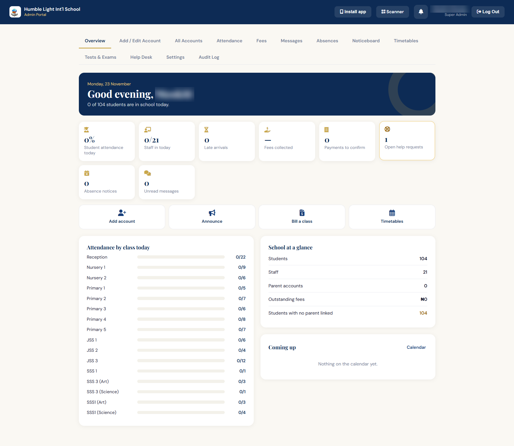

# HLIS School Portal

**Live site:** [hlis.com.ng](https://hlis.com.ng)

Website and admin portal for Humble Light International School, built solo from design to deployment. The platform gives the school a public website and a role-based admin portal to run daily operations: accounts, attendance, fees, communication and exams.

## What it does

**Admin portal**

- **Overview dashboard:** live attendance, staff in today, late arrivals, fees collected, payments to confirm, open help requests, absence notices and unread messages at a glance
- **Accounts:** add, edit and manage student, staff and parent accounts
- **Attendance:** per-class attendance tracking, with a built-in scanner tool
- **Fees:** bill a class, track collected and outstanding fees, confirm payments
- **Communication:** messages, announcements and a noticeboard
- **Absences:** absence notices from parents
- **Timetables:** manage class timetables
- **Tests and exams:** manage assessments
- **Help desk:** requests from users, tracked until resolved
- **Settings and audit log:** configuration and a record of admin actions
- **Installable app:** can be installed on a phone or desktop like a native app
- **Role-based access:** Super Admin and other roles

**Public website**

- School information, academic programs, admissions details and community updates

## Tech stack

- **Frontend:** [fill in, e.g. HTML, CSS, JavaScript]
- **Backend:** [fill in]
- **Database:** [fill in]
- **Hosting:** [fill in]

## My role

Sole developer: requirements, UI design, development, deployment and ongoing maintenance.

## Source code

Private. This is a production system built for a client and contains sensitive data. I'm happy to walk through the architecture and code in an interview.

## Contact

[LinkedIn](https://www.linkedin.com/in/menkiti-chinedu-20738b344)
